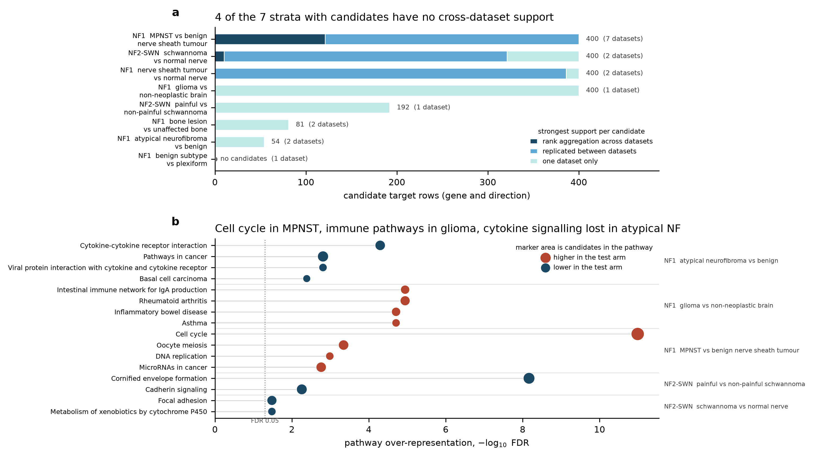

# Phase 3: Candidate Target Identification from Expression Data

Generated by `phase-3/scripts/build_phase3_report.py`. Every current-state number below is recomputed from the committed Phase 3 tables at build time.

## Purpose

Phase 2 left 15 datasets with a ranked differential-expression list. Phase 3 turns those rankings into an expression-derived candidate target list, labelled by disease and manifestation, that Phase 3b can set beside the literature-derived list from Phase 1b.

The launch set spans 28 platforms and most contrasts compare two disease states rather than tumour against normal, so effect sizes are not comparable on a common scale. Phase 3 therefore combines datasets by rank, within strata that never mix a disease-vs-normal reading with a between-state one. The 23 contrasts across 15 datasets fall into 9 such strata, 8 of which carry a contrast usable for candidate generation.

## The eight build steps, in order

1. `phase3_contrast_labels.py` reads the Phase 2 ranked lists, finds every contrast they carry, and labels each one with disease, manifestation(s) and its aggregation stratum. Disease and manifestation are taken from the Phase 1a dataset-level labels and narrowed to the arms the contrast actually compares; the script fails if a narrowed manifestation is not among the ones Phase 1a recorded for that dataset, or if a stratum would mix effect types.

2. `phase3_rank_matrix.py` converts each ranked list into direction-aware normalized ranks over that contrast's own measured symbol set, collapses probes to symbols by largest absolute test statistic, and averages a dataset's several contrasts within a stratum into one dataset-level ranking so no dataset enters aggregation more than once.

3. `phase3_aggregate.R` runs Robust Rank Aggregation per stratum and direction over the gene-by-dataset rank matrix, with unmeasured genes passed in as missing.

4. `phase3_kegg_fetch.py` builds the human symbol-to-pathway map from the KEGG REST API.

5. `phase3_candidates.py` assigns each gene an evidence tier, labels it by disease and manifestation from the datasets that support it, flags the germline NF disease genes, and writes the full table and the filtered candidate deliverable.

6. `phase3_kegg_enrich.py` tests KEGG pathway over-representation per stratum and direction against that stratum's own measured background.

7. `phase3_figure.py` draws Figure 1.

8. `build_phase3_report.py` writes this document.

## Current outputs

| File | Size | What it holds |
|---|---|---|
| `phase-3/data/phase3-contrast-labels.csv` | 23 contrasts | one row per Phase 2 contrast with disease, manifestation(s), stratum, arms and the basis for each label |
| `phase-3/data/phase3-rank-input-summary.csv` | 23 contrasts | what entered the ranking per contrast and what was dropped as unmapped or collapsed to a symbol |
| `phase-3/data/phase3-expression-targets.csv.gz` | 28,576 rows | full table: every gene with expression evidence in a stratum, with its tier and statistics |
| `phase-3/data/phase3-candidate-targets.csv` | 1,927 rows | the filtered deliverable Phase 3b consumes |
| `phase-3/data/phase3-kegg-enrichment.csv` | 5,106 tests | KEGG over-representation per stratum and direction |
| `phase-3/data/phase3-kegg-gene-pathway.tsv.gz` | 39,437 links | symbol to human pathway map the enrichment reads |
| `phase-3/data/phase3-kegg-provenance.json` | 1 record | KEGG endpoints, pathway database stamp and fetch date |
| `phase-3/docs/figures/phase3-expression-evidence.png` | 1 figure | Figure 1, candidates by evidence tier and the pathways they fall in |

## Figure 1



Panel a: candidate rows per stratum, coloured by the strongest support each candidate has, with the number of datasets in the stratum in brackets. Panel b: the KEGG pathways reaching FDR below 0.05, at most four per stratum and direction, marker area proportional to the number of candidates annotated to the pathway. Counts are gene-by-direction rows, so a gene can appear in more than one stratum. n is the number of datasets shown per bar; the unit of replication throughout Phase 3 is the dataset, never the sample.

## How a gene becomes a candidate

Three evidence tiers, recorded per gene per stratum per direction rather than collapsed into one significance call, because the strata differ so much in how many datasets they have:

* **A_aggregated** (131 rows). Robust Rank Aggregation rho passes FDR below 0.05 within the stratum, and at least two datasets measured the gene. The second condition matters: a gene only one dataset measured still receives an RRA score, computed from a single normalized rank, and a top rank in one deep list can pass FDR on its own, which is not an aggregated call.

* **B_replicated** (2096 rows). Significant in its own dataset's differential expression at FDR below 0.05 in two or more datasets of the stratum, in the same direction, with no dataset of the stratum significant in the opposite direction.

* **C_single_dataset** (26349 rows). Significant in exactly one dataset of the stratum. This is every gene from the single-dataset strata, and genes in multi-dataset strata that only one dataset supports.

Rank aggregation can call a gene that no single dataset calls, which is the point of running it: consistently high ranks across many datasets without clearing FDR anywhere. Those genes are kept. In the current tables 2 rows are aggregation calls with no single-dataset call behind them (F10, PYGM).

## Evidence by stratum

| Stratum | Datasets | Contrasts | Effect type | Tier A | Tier B | Tier C | Candidates | KEGG pathways at FDR < 0.05 |
|---|---|---|---|---|---|---|---|---|
| NF1, atypical neurofibroma against a benign arm | 2 | 3 | between state | 0 | 0 | 54 | 54 | 8 |
| NF1, benign neurofibroma subtype against plexiform neurofibroma | 1 | 1 | between state | 0 | 0 | 0 | 0 | 0 |
| NF1, bone lesion against unaffected bone | 2 | 2 | disease vs normal | 0 | 0 | 81 | 81 | 0 |
| NF1, glioma against non-neoplastic brain | 1 | 1 | disease vs normal | 0 | 0 | 7597 | 400 | 23 |
| NF1, MPNST against a benign nerve sheath arm | 7 | 8 | between state | 121 | 1141 | 6525 | 400 | 9 |
| NF1, nerve sheath tumour against normal nerve | 2 | 3 | disease vs normal | 0 | 502 | 5696 | 400 | 0 |
| NF2-SWN, painful against non-painful schwannoma | 1 | 1 | between state | 0 | 0 | 192 | 192 | 2 |
| NF2-SWN, schwannoma against normal nerve | 2 | 2 | disease vs normal | 10 | 453 | 6204 | 400 | 2 |

## Evidence by disease and manifestation

Counts of distinct candidate genes. A gene labelled with several manifestations is counted under each, and the same gene can appear in more than one disease, so the rows do not sum to the table length.

| Disease | Manifestation | Candidate genes | With cross-dataset support | Strata |
|---|---|---|---|---|
| NF1 | Malignant peripheral nerve sheath tumor (MPNST) | 780 | 766 | 2 |
| NF1 | Plexiform neurofibroma | 743 | 690 | 3 |
| NF1 | Optic pathway glioma | 400 | 0 | 1 |
| NF1 | Cutaneous neurofibroma | 398 | 386 | 1 |
| NF1 | Bone defects | 81 | 0 | 1 |
| NF1 | ANNUBP / atypical neurofibroma | 54 | 0 | 1 |
| NF2-SWN | Vestibular schwannoma | 585 | 321 | 2 |
| NF2-SWN | Non-vestibular schwannoma | 192 | 0 | 1 |
| NF2-SWN | Pain | 192 | 0 | 1 |

SWN, schwannomatosis without an NF2 germline variant, has no dataset in the Phase 2 launch set and therefore no expression-derived candidate. That is an explicit zero for Phase 3b, not an omission.

## Top candidates

The five strongest candidates per stratum and direction, by the stratum's priority statistic. Fold changes are from the supporting dataset with the smallest FDR and are not comparable between strata.

| Stratum | Direction | Top five | Tier of the first |
|---|---|---|---|
| NF1, atypical neurofibroma against a benign arm | higher in test arm | TP53 | C_single_dataset |
| NF1, atypical neurofibroma against a benign arm | lower in test arm | CPA3, TPM1, WNT2B, SFRP4, MS4A2 | C_single_dataset |
| NF1, bone lesion against unaffected bone | higher in test arm | PTGFR, SCX, MAB21L2, VAX1, PLCH2 | C_single_dataset |
| NF1, bone lesion against unaffected bone | lower in test arm | JPH2, RASD2, MEIS2, HOXB3, ALPL | C_single_dataset |
| NF1, glioma against non-neoplastic brain | higher in test arm | TIMP4, STK32A, MAT2A, STON1, GALNT5 | C_single_dataset |
| NF1, glioma against non-neoplastic brain | lower in test arm | EMX1, NRGN, PSD, CAMK2A, SEPTIN5 | C_single_dataset |
| NF1, MPNST against a benign nerve sheath arm | higher in test arm | BIRC5, RRM2, CENPF, PRAME, TOP2A | A_aggregated |
| NF1, MPNST against a benign nerve sheath arm | lower in test arm | ADH1B, LMOD1, TNXB, PALMD, TACC1 | A_aggregated |
| NF1, nerve sheath tumour against normal nerve | higher in test arm | PTGFRN, TWIST1, SOX11, FAM110B, PMAIP1 | B_replicated |
| NF1, nerve sheath tumour against normal nerve | lower in test arm | CRYGS, GFAP, TMC7, PCBP4, SECISBP2L | B_replicated |
| NF2-SWN, painful against non-painful schwannoma | higher in test arm | ST3GAL6, CDH7, LIMCH1, SEC31A, NRG1 | C_single_dataset |
| NF2-SWN, painful against non-painful schwannoma | lower in test arm | KRT6A, KRT6B, SDCBP, SREK1, CALML3 | C_single_dataset |
| NF2-SWN, schwannoma against normal nerve | higher in test arm | RAB31, SORL1, NAPSB, STX11, PREX1 | A_aggregated |
| NF2-SWN, schwannoma against normal nerve | lower in test arm | SLC2A1, AKR1C1, SVIP, SLC27A6, SLC22A3 | A_aggregated |

## Pathway enrichment

KEGG pathway database stamp `pathway KEGG pathway maps | path 587 entries | Last update 2026/10/28`, fetched 2026-11-03 from `https://rest.kegg.jp/link/pathway/hsa` and the three sibling endpoints listed in `phase3-kegg-provenance.json`. Endpoint syntax was checked against https://www.kegg.jp/kegg/rest/keggapi.html before the query code was written. The map covers 9,289 symbols over 372 human pathways.

Earlier phases mapped pathways for target names chosen by hand. This step runs the other way, from each stratum's whole measured symbol set to the pathways its candidates fall in, which is what the plan means by extending the KEGG step to work from expression data. The background is the stratum's own measured symbols intersected with the pathway-annotated genes, not all of KEGG: using all of KEGG would score a pathway as enriched merely because the stratum's platforms covered it well, which is how a targeted panel manufactures enrichment. GSE239561's 770-gene panel is itself pathway-selected, so this matters most for the two strata it contributes to.

44 pathway tests reach FDR below 0.05. The pattern per stratum:

* NF1, atypical neurofibroma against a benign arm, lower in the test arm: Cytokine-cytokine receptor interaction, Viral protein interaction with cytokine and cytokine receptor, Pathways in cancer, Basal cell carcinoma. Strongest FDR 5e-05.

* NF1, glioma against non-neoplastic brain, higher in the test arm: Intestinal immune network for IgA production, Rheumatoid arthritis, Asthma, Inflammatory bowel disease. Strongest FDR 1.1e-05.

* NF1, MPNST against a benign nerve sheath arm, higher in the test arm: Cell cycle, Oocyte meiosis, DNA replication, MicroRNAs in cancer. Strongest FDR 1e-11.

* NF2-SWN, painful against non-painful schwannoma, lower in the test arm: Cornified envelope formation, Cadherin signaling. Strongest FDR 6.8e-09.

* NF2-SWN, schwannoma against normal nerve, lower in the test arm: Focal adhesion, Metabolism of xenobiotics by cytochrome P450. Strongest FDR 0.033.

## Scope decisions

* **Germline NF disease genes are flagged out of the candidate list.** NF1, NF2, SMARCB1, LZTR1 and SPRED1, the same gene set and the same reason as Phase 1b: their role is established and re-prioritising them tells the project nothing. 16 rows carry `driver_gene = True` in the full table and are absent from the candidate file. The flag is a column, never a deletion, so the decision is reversible by changing one filter.

* **Two contrasts contribute no candidates.** GSE141801 treated_vs_control, GSE239561 cellular_nf_vs_pnf. Both are kept in the contrast table with the reason in the `basis` column. The first compares a treated arm against the control arm, so it reads drug response rather than disease state; the second has a single sample in its test arm.

* **Fold change is not thresholded.** The launch set's log2 fold changes come from limma, DESeq2, two-colour limma, NanoString housekeeping limma and pseudobulk limma across 28 platforms, and are not on a common scale, which is the reason this phase ranks rather than pools. A shared fold-change cutoff would be stricter for some engines than others. Per-dataset fold changes are reported in the tables for reference and should not be compared between strata.

* **A prioritisation cap of 200 genes per stratum per direction** keeps the candidate deliverable comparable between strata, so one deeply sequenced single dataset cannot dominate the Phase 3b coverage picture against a replicated stratum. The full table carries every gene with evidence; the cap is one argument to `phase3_candidates.py`.

## Limitations

* **Most strata have two datasets, and Robust Rank Aggregation has almost no power there.** With two lists the best attainable rho is bounded by the product of two near-top ranks, and after Benjamini-Hochberg across tens of thousands of genes it rarely clears 0.05. Tier A is empty for 6 of the 8 strata, and for 3 of the 5 strata that have more than one dataset at all. That is a statement about the launch set rather than about the biology; tier B exists so those strata are not reported as evidence-free.

* **3 strata rest on one dataset** and can show no replication at all: NF1, benign neurofibroma subtype against plexiform neurofibroma, NF1, glioma against non-neoplastic brain, NF2-SWN, painful against non-painful schwannoma. Every gene from these strata carries `unreplicated = True`, and the benign subtype comparison produced no significant gene in its single contrast and so no candidate at all.

* **The two bone datasets have two samples per arm each.** Every one of the 81 bone candidates is supported by GSE234071 alone, so the stratum's evidence comes from one dataset despite the stratum having two.

* **GSE232516's reference arm is unaffected tissue from a different anatomical site** in the same patients, not a healthy donor. Its manifest effect type reads disease_vs_normal; what it measures is a between-site difference.

* **The painful-schwannoma stratum's strongest pathway is cornified envelope formation**, which is a skin signature rather than a nerve one and most likely reflects differing amounts of overlying tissue between the two arms. It is reported as found, not interpreted as biology.

* **Pseudobulk single-cell strata mix cell compositions.** GSE318927 and GSE232516 are pseudobulk profiles, so a candidate there can reflect a shift in which cells are present rather than a change within a cell type.

* **GSE292071 has no ranked list** and so contributes nothing to Phase 3, and the 5 datasets Phase 2 ingested without ranking are absent by construction.

## How to reproduce

From the repository root, with the Phase 2 ranked lists in `<ranked-dir>` and a scratch `<build-dir>`. The ranked lists are not committed; they are the Phase 2 artifact `phase2-ranked-lists.tar.gz`.

```sh
python  phase-3/scripts/phase3_contrast_labels.py --ranked-dir <ranked-dir>
python  phase-3/scripts/phase3_rank_matrix.py     --ranked-dir <ranked-dir> --build-dir <build-dir>
Rscript phase-3/scripts/phase3_aggregate.R        <build-dir>
python  phase-3/scripts/phase3_kegg_fetch.py
python  phase-3/scripts/phase3_candidates.py      --build-dir <build-dir>
python  phase-3/scripts/phase3_kegg_enrich.py     --build-dir <build-dir>
python  phase-3/scripts/phase3_figure.py
python  phase-3/scripts/build_phase3_report.py
```

Python steps need pandas, numpy and scipy. The aggregation step needs R with RobustRankAggreg and data.table. `phase3_kegg_fetch.py` is the only step that touches the network; rerunning it refreshes the pathway map and its provenance stamp, and the KEGG REST service throttles repeat callers, so it retries on timeout rather than failing.

## Open items for Phase 3b

Phase 3b is a human decision point. What it now has from both sides:

* The literature-derived candidate list from Phase 1b, in `phase-1b/data/phase1b-candidate-targets.csv`.

* This expression-derived list, 1,755 distinct genes over 7 strata, with each gene's support tiered so a manifestation backed by one dataset is visibly different from one backed by seven.

* An explicit zero for SWN and for every manifestation of the fixed vocabulary that no dataset in the launch set speaks to.
