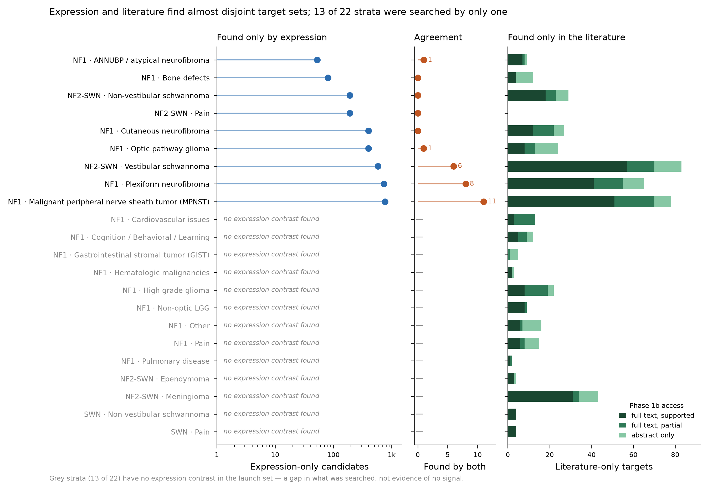

# Phase 7: Literature Validation Layer

Run 2026-11-17. Compares the expression-derived candidate list (Phase 3) against the
literature-derived candidate list (Phase 1b), and runs a literature fallback for the
strata an unusable dataset left without expression evidence.

Methodological calls were ratified by Kara before any comparison code was written and
are recorded in `phase7-contract.md`, which is the authority for this phase. This file
reports results against that contract.

## Headline

**The two approaches find almost disjoint target sets.** Across all 22 strata holding
any candidate, 27 gene x stratum pairs are found by both, against 3,398 expression-only
candidates and 479 literature-only gene rows. Those 27 pairs collapse to 23 unique
genes.

This is not primarily disagreement. It is two instruments measuring different things,
and the figure below is the honest statement of how little they were ever in a position
to confirm each other.

## What was compared

| side | source | size |
|---|---|---|
| expression | `phase-3/data/phase3-candidate-targets.csv`, `manifestations` exploded | 3,425 gene x disease x manifestation cells, 9 strata |
| literature | `phase-1b/data/phase1b-candidate-targets.csv`, all rows | 303 rows, 22 strata |

Phase 6's scored table is **not** an input — its `s_literature` component derives from
the same Phase 1b table, so scoring agreement between them would be partly circular.
Phase 6's score is attached only after a row's match class is decided. The Phase 4 join
is not an input either: it restricted the literature side to strata with expression
candidates and so dropped 91 of the 303 rows, which Phase 7 reinstates.

Outputs: `phase7-list-comparison.csv` (3,904 rows), `phase7-near-misses.csv` (225),
`phase7-comparison-summary.json`, all regenerated by
`phase-7/scripts/phase7_compare_lists.py`.

## Match classes

| match class | rows |
|---|---|
| `both_exact_named_gene` | 20 |
| `both_via_composite_label` | 7 |
| `expression_only` | 3,398 |
| `literature_only` | 327 |
| `literature_only_no_expression_contrast_found` | 152 |

The 27 both-pairs reconcile **exactly, stratum by stratum**, with the `overlap_genes`
Phase 3b recorded: 11 MPNST, 8 plexiform neurofibroma, 6 vestibular schwannoma, 1 optic
pathway glioma, 1 ANNUBP.

The 23 unique genes found by both:

- **MPNST (11)** — BIRC5, RRM2, CENPF, DLK1, PTEN, PLK1, TGFBR3, SOX10, SPP1, and via
  composite labels EZH2 (through `PRC2 (EED/SUZ12/EZH2)`) and E2F1 (through `RB/E2F`)
- **Plexiform neurofibroma (8)** — BIRC5, EGFR, PROS1, KIT, POSTN, SOX10, SPP1, and
  FGFR1 via `FGFR`
- **Vestibular schwannoma (6)** — CD44, EGFR, YAP1, and via composite labels WWTR1
  (through `YAP1/WWTR1 (YAP/TAZ)`), PAK3 (through `PAK (family)`), CEMIP (through
  `HYALURONAN`)
- **Optic pathway glioma (1)** — MAPK3, via `MAPK pathway`
- **ANNUBP (1)** — TP53

### Correction to contract Call 1

The contract predicted 16 exact + 6 composite = 22 unique genes. The built comparison
gives 23. The extra gene is **CEMIP**, reached through the Phase 1b label `HYALURONAN`
whose `label_type` is `other` — a type Call 1's enumeration of family/pathway/complex
did not cover. Phase 7 expands every Phase 1b row carrying `constituent_genes`, which is
the rule Phase 3b used and the reason the 27 reconciles. Narrowing expansion to
family/pathway/complex only would reproduce the contract's 22 but break the reconciliation
against Phase 3b. The count in the contract is superseded by this file.

CEMIP is also the weakest of the 27: an `other`-typed label, abstract-only evidence,
access weight 0.3.

## Why agreement is thin

The two lists are asymmetric by construction, and the low overlap substantially measures
that asymmetry rather than contradiction:

- Phase 3 ranks every gene in a transcriptome-wide contrast and truncates at 200 per
  comparison class. A gene is expression-only if it ranked 201st.
- Phase 1b lists what a curator judged worth naming, including 56 in-stratum
  family/pathway/complex labels that have no single gene to match against.
- Manifestation matching is generous on the expression side and strict on the literature
  side. 398 NF1 genes carry three manifestation labels from one PNST-vs-normal contrast.
  `expr_manifestation_specific` is False on those rows and must gate any claim that a
  gene was found in a *specific* manifestation.

At curated-label level rather than gene level: of 303 Phase 1b rows, **30 matched**, 182
did not despite an expression contrast being available in that stratum, and 91 sit in
strata with no expression contrast found.

Matched literature rows are better-evidenced than unmatched ones (mean access weight
0.83 against 0.77 for the no-contrast group), but with 30 matched rows this is a
description of the sample, not a tested effect.

## Near misses

225 rows in `phase7-near-misses.csv`.

**Cross-manifestation (169, of which 99 cross-disease).** Pairs that are an artefact of
one multi-label comparison class are excluded, so these are genes independently reached
in different manifestations.

**Shared pathway (56).** Rule: Phase 3 KEGG enrichment FDR < 0.05, pathway size <= 100
distinct human genes, and the expression gene actually drove that enrichment. The size
cut is load-bearing — relaxing it to 150 takes the output from 56 rows to 540.

Two signatures dominate and should not be read as 56 independent findings:

- **The genuine find:** literature target **PARP1** in NF1 MPNST against five
  base-excision-repair expression candidates — LIG1, POLD1, NEIL3, FEN1, RFC2 — all at
  expression tier `B_replicated` in a 44-gene pathway. This is the most specific
  mechanism-level convergence in the phase.
- **Second:** literature target `PI3K/AKT/GSK3β` in plexiform neurofibroma against
  WNT2B, GLI1, WNT11, BMP2, WNT10A (single dataset, so weaker).
- **Redundant:** 34 of the 56 rows are one immune-infiltration signature in optic pathway
  glioma — 14 expression genes, 6 of them HLA class II (HLA-DRA, HLA-DRB1, HLA-DPA1,
  HLA-DPB1, HLA-DMA, HLA-DOA) plus 8 others (IFNGR1, ITGA4, CD44, CCL3, IL18, CTSK,
  CSF2RA, ATP6V0A2) — counted once against each of four immune pathways and three different
  literature targets (`MAPK pathway`, VEGFA, CSF1R). It is one observation, not many.

## Access weighting

Applied exactly as Call 3 specifies — `full text - supported` 1.0, `full text - partial`
0.6, `abstract only` 0.3, verified to hold on every row. `preprint_only` is a separate
flag and is not folded into the weight.

Of 479 literature-only gene rows, 380 have at least one paper read in full and **99 rest
on abstracts alone**. Abstract-only concentration is uneven and matters per stratum: NF1
Bone defects 8 of 12, NF1 Other 9 of 16, NF1 GIST 4 of 5, NF1 optic pathway glioma 11 of
24, against NF2-SWN vestibular schwannoma 13 of 83 and NF1 MPNST 8 of 78.

## Literature fallback for unusable datasets

### Scope, corrected

An earlier reading in this session claimed the five ingested-but-unrankable datasets map
onto the deferred strata. That was wrong. Of 18 unusable-dataset x stratum pairs (5
ingested-no-ranking, 7 removed at the Phase 2 pre-flight review), only **three** leave a
stratum with no expression evidence; the rest are strata other launch-set datasets still
cover. Losing GSE181985 did not leave plexiform neurofibroma uncovered — it still has 743
expression candidates. Full table: `phase7-fallback-scope.csv`.

| stratum | dataset lost | why unusable |
|---|---|---|
| NF2-SWN Meningioma | GSE232528 | 14 NF2-patient meningiomas, single arm |
| NF1 Non-optic LGG | GSE5675 | removed at pre-flight; 0 samples in scope |
| NF1 Other | GSE2841 | removed at pre-flight; 2 samples in scope |

### Result

A 14-query PubMed bank (frozen before the run, relevance-sorted, from 2005, 25 results
per query) returned 279 unique PMIDs; 275 abstracts were retrieved and 276 stratum-paper
pairs screened. 41 papers yielded a claim, 32 had a PMCID, 22 returned a usable body.
Output is **61 candidate rows over 39 papers**, every row carrying a PMID.

| stratum | rows | full text - supported | partial | abstract only |
|---|---|---|---|---|
| NF2-SWN Meningioma | 39 | 19 | 4 | 16 |
| NF1 Other | 13 | 6 | 0 | 7 |
| NF1 Non-optic LGG | 9 | 1 | 0 | 8 |

**New versus already held.** 34 of 61 rows are absent from Phase 1b under an exact label
match, but 9 of those reach a Phase 1b target through a composite label (`novelty_basis =
composite_label_partly_held_by_phase1b`), so **25 are novel on label and constituents
together** (`novelty_basis = not_in_phase1b`).

**8 of those 25 are anchored in a paper read in full** — CD274 (PD-L1), FAT3/4, VGLL4,
PAK1 and RAC1 in NF2-SWN Meningioma; CYBB (NOX2), NCF1 and PRKCD in NF1 Other. All 8 are
`full text - supported`. The other 17 rest on an abstract nobody has checked.

Separately, 5 of the 9 partly-held composite rows are also full-text supported — Hippo
pathway, PI3K-AKT-MTOR axis, MTORC1, MTORC2 and the YAP1-MAML2 fusion, all in NF2-SWN
Meningioma. These are **not** novel on constituents: each reaches a target Phase 1b
already holds. They are listed here because the full-text support is real, not because
the target is new. Pooling them with the 8 to claim "13 novel and verified" would
overstate novelty, and an earlier draft of this file did exactly that.

**NF1 Non-optic LGG is a gap the fallback did not close.** 1 of its 9 rows is full-text
supported and that row (`MAP2K1/2 (MEK1/2)`) is already in Phase 1b. 7 of the 9 carry a
manifestation-attribution flag because their source is a mixed-site paediatric LGG series
in which the non-optic location of the NF1 cases is not established.

Outputs: `phase7-fallback-candidates.csv`, `phase7-fallback-queries.csv`,
`phase7-fallback-curation.json` (38 label renames, 6 scope drops, 13 caveat flags, held
as data rather than hand-edited), regenerated by `phase7_fallback_literature.py`.

## Limits a reader must carry

1. **Fallback recall is capped, not swept.** 25 relevance-ranked results per query; 5 of
   the 14 queries sit on larger pools (281, 199, 106, 87, 61 hits) and were sampled. 4 of
   279 PMIDs returned no metadata and were never screened. No count here supports a claim
   that a target is *absent* from the literature.
2. **Full text came only through the connector's PMC route** — 22 of 41 claim-bearing
   papers. Phase 1b also used NCBI efetch and Europe PMC, which reach different subsets.
   The abstract-only share is a property of this retrieval route, not of what is publicly
   readable.
3. **The PMC text extraction drops italic markup**, and journals italicise gene symbols,
   so a symbol can vanish from a retrieved body (`the <i>FAT2</i> gene` arrives as
   `thegene`). 17 of 22 bodies show the signature. A symbol-presence guard now voids any
   `not supported` verdict returned against a body in which the label never appears — 2
   claims (RNF213, MRVI1) were voided and held at the abstract tier instead, and 8 of 46
   verdicts were reached through a body's alternative naming. **Any later phase using this
   connector for verification needs the same guard.**
4. **Verification is a single model reader**, no second reader, no adjudication — as in
   Phase 1b. It disagreed with Phase 1b twice (see open items). Treat verdicts as
   provisional.
5. `literature_only_no_expression_contrast_found` means the launch set contained no
   contrast for that stratum. It is not evidence the gene is not differentially expressed
   there.
6. Both near-miss kinds are same-gene or same-pathway heuristics. No mechanism-level or
   ortholog-level matching was attempted.
7. `expr_rank_in_stratum` is Phase 3's rank scoped to the comparison class, not to the
   exploded stratum, so ranks are not comparable across strata drawing on several classes.

## Rulings made after the first run (2026-11-17)

Four of the open items below were put to Kara and settled the same day. What changed:

**Fallback scope stays narrow.** The Phase 7 prompt says "any dataset flagged unusable";
the run covered only the 3 strata left with no expression evidence. Ratified as correct —
a fallback replaces missing evidence, and the other 5 strata hold 192 to 780 expression
candidates each.

**Pheochromocytoma is now a manifestation term.** Five rows moved out of `Other`
(RET, SOX9, HEY1 from PMID 17582688; ESR1, GPER1 from PMID 39804847) through
`manifestation_relabels` in the curation file. `Other` is left with 8 vasculopathy and
endothelial rows, which is one biology rather than two. Every row in the new stratum is
`abstract only` — it holds no full-text-verified evidence. No Phase 1b row needed
relabelling: none of its 11 `Other` rows concerns pheochromocytoma.

**Unstated germline status is penalised, not excluded.** The labeling standard already
excluded sporadic material, which I failed to show Kara when framing the question. Both
halves now stand: material *established* as sporadic stays excluded; a paper that merely
never states germline status is kept with `scope_flag` and a numeric penalty.
`germline_attribution_weight` is 0.5 on 6 rows, 1.0 on the other 55, set by
`GERMLINE_UNESTABLISHED_WEIGHT` at the top of the fallback script.

Both corrections are applied by a `postcurate` stage in
`phase7_fallback_literature.py`, which reads the curation file and needs no `work/` cache.
They are therefore produced by the generating script rather than hand-edited into the CSV,
and re-running the stage is idempotent. Re-running the full pipeline was rejected
deliberately: it would re-fetch 279 papers and re-roll every model verdict, including the
verdicts whose stability is being measured.

**The DisMech mechanism near-miss pass is dropped, and measuring it found a defect.**
The pass cannot be built: 33 of 126 nodes carry genes and name 13 distinct genes between
them, all germline drivers, so a gene-membership pass returns zero pairs and structurally
cannot return any; the GO layer is 26 broad process terms, which would be noisier than the
KEGG pass it was meant to improve. Separately, `phase5-dismech-mechanisms.csv` writes
`go_terms` as a sorted set of IDs while `go_labels` and `go_modifiers` are in source order,
so **80 of 92 term-label pairs in the 46 multi-term nodes are mismatched** (verified against
QuickGO; all 60 single-term nodes are correct). Phase 5's own results are unaffected — its
cross-disease screen uses the IDs as a set — but the table must never be paired by index.
The fix is ratified as its own PR off main.

## Open items for the PI

1. **Two single-reader disagreements with Phase 1b, nothing changed in Phase 1b.**
   `YAP/TAZ` against PMID 36148553 returned `not_supported` here although Phase 1b records
   that paper as full-text support for `YAP1/WWTR1 (YAP/TAZ)` in meningioma; and a repeat
   call on PMID 39367156 returned `supported` for RNF213 where the batch run returned
   `not supported`. Both are flagged, neither acted on.
2. **RESOLVED 2026-11-17 — sporadic versus germline scope.** Established sporadic material
   stays excluded under the standing rule; a paper that merely never states germline status is
   kept, flagged and penalised at 0.5. 13 rows carry a `scope_flag` in total: 7 are
   `manifestation attribution not verified` in NF1 Non-optic LGG, and 6 are
   `germline NF attribution not established` — CRL4-DCAF1 and HERV-K (PMID 34853069,
   merlin-negative primary cells the paper says arise spontaneously or in NF2 without
   separating them), `MAPK pathway` (42411653, a mostly-sporadic optic nerve sheath meningioma
   review), PTEN (41497607, NF2-mutant by tumour genotype), and ESR1 and GPER1 in NF1
   Pheochromocytoma (39804847, where `NF1` denotes the molecular cluster). That is 4 meningioma
   rows over 3 papers — an earlier draft of this file said "five meningioma papers", which was
   repeated from a summary rather than counted from the table.
3. **RESOLVED 2026-11-17 — Pheochromocytoma added to the vocabulary.** The fixed list had no
   term for it, which is why NF1 pheochromocytoma work landed in `Other` at all, and why the
   fallback had to scope `Other` to pheochromocytoma and vasculopathy/endothelial biology by
   hand. Five rows were relabelled; see the rulings section above.
4. **MPNST PARP1 convergence is worth a targeted look** — a literature target and five
   replicated expression candidates in the same 44-gene pathway is the closest thing this
   phase found to independent corroboration at mechanism level.
